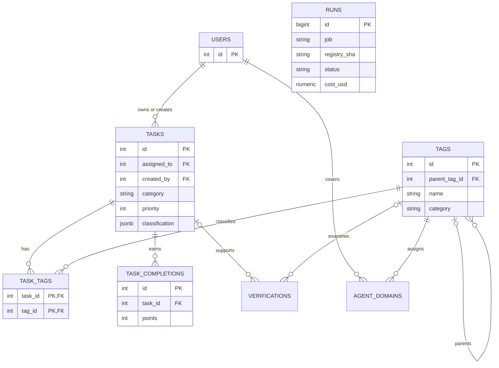

# Omni OS data model

Atma and core use separate Postgres databases. This diagram shows the records involved in task capture, classification, completion and execution. The SQL migrations define the full physical schema.

Category is a value on a task or tag. The four graph roots are generated. A top-level tag has a null parent. Task membership is many-to-many. Reparenting changes the current rollup while the original classification snapshot retains its proposed path and selected ID. Old tasks can have a null snapshot. The growth dashboard reads a 28-day SQL view, whereas the mindmap renderer aggregates stored completion points by traversing ancestors.

The YAML registry identifies jobs by name. Each run records that name and registry revision in the core database. These fields are a logical reference across storage systems. Model calls from Atma are currently direct requests and produce no core run record. Company sprint cards live outside both databases.
